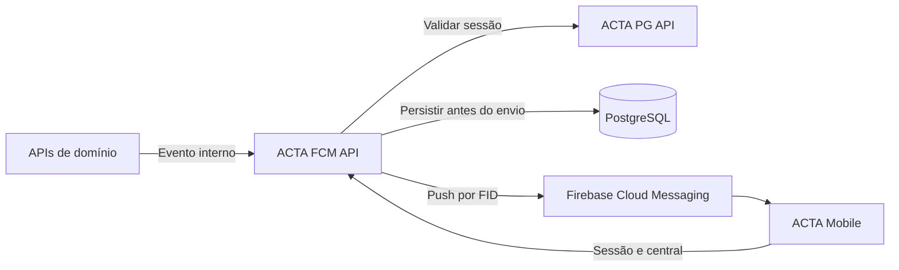

# 🔔 ACTA FCM API

API de notificações do ACTA, migrada para este novo repositório, para acompanhar atribuições, prazos e atividades do ciclo **PDCA** (*Plan, Do, Check, Act*) pela central e pelo Firebase Cloud Messaging.

## 📌 Visão geral

O `acta-fcm-api` recebe eventos internos, valida destinatários e grava as notificações em `auditoria.notificacao`. Para os tipos com push, tenta enviar uma mensagem pelo Firebase depois do commit. A central permanece disponível mesmo quando o push falha.

As APIs de domínio continuam responsáveis pelas alterações de negócio e pela emissão dos eventos após uma transição efetiva. O catálogo deste serviço define os tipos aceitos; sua presença no catálogo não confirma que os produtores já estejam integrados.

## ✨ Funcionalidades

| Domínio | Capacidades |
| --- | --- |
| Central | Listagem por usuário, filtro de categoria e não lidas, contador e marcação individual ou em lote. |
| Dispositivo | Registro, substituição e revogação de um Firebase Installation ID (FID) por usuário. |
| Eventos internos | Validação de tipo, entidade, deep link e destinatários ativos da empresa; deduplicação por destinatário e chave de ocorrência. |
| Push | Texto fixo por evento, saudação com primeiro nome do cadastro e payload com apenas `notificationId`; remoção condicional de FID rejeitado. |
| Autenticação | Sessão mobile validada pela `acta-pg-api` e segredo próprio para produtores internos. |

## 🛠️ Tecnologias

| Tecnologia | Uso |
| --- | --- |
| Python 3.12 | Runtime do contêiner e da validação contínua. |
| FastAPI 0.141.1 | Rotas HTTP, validação e documentação OpenAPI. |
| Uvicorn 0.52.3 | Servidor da aplicação. |
| PostgreSQL / psycopg2-binary 2.9.13 | Persistência da central e consulta de usuários. |
| Firebase Admin SDK 7.7.0 | Envio de mensagens por FID usando credenciais de servidor. |
| HTTPX 0.28.1 | Consulta da sessão na API PostgreSQL. |
| python-dotenv 1.2.2 | Leitura do `.env` local. |
| Docker / GitHub Actions | Imagem da API e workflows de validação e publicação. |

As dependências estão fixadas em [requirements.txt](requirements.txt). A versão do servidor PostgreSQL depende do ambiente.

## ⚙️ Pré-requisitos e configuração

Tenha Python 3.12, PostgreSQL com `auditoria.notificacao` e `public.usuario_sistema` compatíveis com as consultas, acesso à `acta-pg-api` e um projeto Firebase com Cloud Messaging configurado.

O cadastro de usuário deve possuir a coluna **`firebase_fid`**, usada como destino do push. `firebase_uid` identifica a conta autenticada e não substitui o FID. O aplicativo deve enviar o FID de uma instalação registrada para FCM, não um ID Token de login nem um token de registro FCM no campo de FID.

Este serviço usa a estrutura existente e não cria tabelas nem executa migrações.

Crie um `.env` com base no [.env.example](.env.example), preservando qualquer configuração local já existente:

```powershell
if (-not (Test-Path .env)) { Copy-Item .env.example .env }
```

| Variável | Uso |
| --- | --- |
| `DB_URL` | URL PostgreSQL com usuário autorizado a consultar usuários, atualizar `firebase_fid` e ler/gravar notificações. |
| `ACTA_PG_API_URL` | URL base da API de autenticação, incluindo o prefixo das rotas; o serviço acrescenta `/me`. |
| `INTERNAL_API_TOKEN` | Segredo compartilhado com os produtores, enviado em `X-Internal-Token`. |
| `FIREBASE_PROJECT_ID` | Identificador do projeto Firebase usado para envio. |
| `GOOGLE_APPLICATION_CREDENTIALS` | Caminho de uma credencial de servidor quando o ambiente não fornece Application Default Credentials. |
| `PORT` | Porta do contêiner; padrão `8082`. Na execução local, use `--port` do Uvicorn. |

Obtenha a URL e as permissões de banco com o responsável pelo ambiente; configure a URL da PG API conforme o endpoint publicado. O projeto e a identidade de servidor Firebase devem pertencer ao ambiente utilizado. Nunca versione `.env`, segredos ou arquivos de credenciais.

## 🚀 Execução local

No PowerShell, crie o ambiente virtual e instale as dependências:

```powershell
python -m venv .venv
.\.venv\Scripts\python.exe -m pip install -r requirements.txt
.\.venv\Scripts\python.exe -m uvicorn app.main:app --reload --host 127.0.0.1 --port 8082
```

Em Linux/macOS, utilize `.venv/bin/python` nos mesmos comandos. A API fica disponível em `http://localhost:8082`.

### Docker

```powershell
docker build -t acta-fcm-api .
docker run --rm -p 8082:8082 --env-file .env acta-fcm-api
```

Disponibilize Application Default Credentials ao contêiner pela identidade do ambiente ou por arquivo montado somente para leitura, com `GOOGLE_APPLICATION_CREDENTIALS` apontando para o caminho interno. Não copie credenciais para a imagem. Banco e PG API precisam ser alcançáveis pela rede do contêiner; `localhost` dentro dele aponta para o próprio contêiner.

## 📚 Documentação e autenticação

- Swagger UI: `http://localhost:8082/docs`
- ReDoc: `http://localhost:8082/redoc`
- OpenAPI: `http://localhost:8082/openapi.json`
- Saúde: `GET /health`, público e sem consulta a banco, PG API ou Firebase.

As rotas `/api/v1/me/...` recebem `Authorization: Bearer <FIREBASE_ID_TOKEN>`. A API consulta `GET {ACTA_PG_API_URL}/me` e obtém `idUsuario` e `idEmpresa` da sessão. O app não escolhe o destinatário da central.

O endpoint interno recebe `X-Internal-Token: <INTERNAL_API_TOKEN>`. Atualmente os produtores compartilham o mesmo segredo e o catálogo de eventos aceitos; não há permissões específicas por produtor. Disponibilize essa rota somente aos serviços autorizados.

## 🔌 Endpoints

| Método e rota | Uso |
| --- | --- |
| `GET /api/v1/me/notificacoes` | Lista itens não expirados, mais recentes primeiro; filtros `apenasNaoLidas` e `categoria`. |
| `GET /api/v1/me/notificacoes/nao-lidas/quantidade` | Retorna a quantidade de não lidas não expiradas. |
| `PATCH /api/v1/me/notificacoes/{id_notificacao}/lida` | Marca um item do usuário como lido de forma idempotente. |
| `POST /api/v1/me/notificacoes/lidas` | Marca todas as não lidas não expiradas do usuário; retorna a quantidade alterada. |
| `PUT /api/v1/me/dispositivo` | Recebe `{"fidFirebase":"<FIREBASE_INSTALLATION_ID>"}`; retorna `204`. |
| `DELETE /api/v1/me/dispositivo` | Remove o FID do usuário; retorna `204`. Deve ser chamado antes de encerrar a sessão no logout. |
| `POST /internal/v1/eventos` | Persiste evento e tenta push conforme o catálogo; retorna quantidades criada e duplicada. |

A listagem retorna um array sem paginação. Cada item contém `id`, `tipo`, `categoria`, `tipoEntidade`, `idEntidade`, `deepLink`, `criadoEm`, `lidoEm` e `expiraEm`. O app pode renderizar o texto pelo tipo e deve validar acesso ao destino pelas APIs autenticadas.

### Evento interno

Exemplo fictício de corpo JSON; use IDs e uma chave de ocorrência válidos no ambiente:

```json
{
  "idEvento": "evento-tarefa-987-atribuicao-3",
  "tipoEvento": "TAREFA_ATRIBUIDA",
  "ocorridoEm": "2026-10-15T09:00:00-03:00",
  "idEmpresa": 42,
  "idsDestinatarios": [123],
  "tipoEntidade": "TAREFA",
  "idEntidade": "987",
  "deepLink": "acta://tarefas/987",
  "chaveDeduplicacao": "tarefa-atribuida:987:versao-3"
}
```

O contrato aceita até 100 destinatários por requisição e exige data com fuso. O deep link deve corresponder à rota da entidade no [catálogo](app/schemas/catalogo.py). A deduplicação utiliza `chaveDeduplicacao` e destinatário, não `idEvento`; repetir o evento não cria outra notificação nem reenvia push.

O catálogo contempla tarefas, prazos, ciclos, treinamentos, formulários, falha de importação e lição aprendida. Consulte o arquivo para tipos e canais exatos. Os produtores são responsáveis por confirmar a transição real e resolver os destinatários elegíveis.

## ⚠️ Erros e limites de entrega

Os erros seguem o formato ACTA:

```json
{
  "mensagens": ["Deep link não permitido para a entidade"],
  "httpStatus": 422,
  "timestamp": "2026-10-15T09:00:00"
}
```

| Código | Uso |
| --- | --- |
| `400` | Contrato ou parâmetros inválidos. |
| `401 / 403` | Credencial ausente/inválida ou acesso negado. |
| `404` | Notificação não encontrada para o usuário ou rota inexistente. |
| `422` | Tipo, categoria, entidade, deep link ou destinatário rejeitado. |
| `502 / 503` | Falha na integração de autenticação, configuração ausente ou banco indisponível. |
| `500` | Erro interno inesperado. |

O push é uma tentativa após a persistência, sem retry durável. A resposta do evento confirma o processamento da central e não a exibição no celular. O corpo usa texto fixo e pode incluir o primeiro nome do destinatário; os dados enviados contêm somente a referência da notificação. O FID não aparece nas respostas nem no conteúdo da mensagem.

Há um dispositivo ativo por usuário. Registrar outro FID substitui o anterior; registrar o mesmo FID em outra conta remove sua associação antiga. A API não executa jobs de lembretes nem aplica janela silenciosa. O [plano de lembretes](docs/plano-lembretes.md) descreve a proposta de evolução.

## 🏗️ Arquitetura e estrutura



```text
app/
├── database/       # conexão PostgreSQL
├── repositories/   # SQL da central e dos usuários
├── routes/         # health, central, dispositivo e eventos
├── schemas/        # contratos HTTP, tipos e catálogo
├── services/       # autenticação, validação de eventos e FCM
├── config.py       # variáveis de ambiente
├── error_handlers.py
└── main.py         # aplicação FastAPI
tests/              # testes com dublês e verificações HTTP locais
```

## 🧪 Validação e entrega

```powershell
.\.venv\Scripts\python.exe -m pip install pytest==9.1.1
.\.venv\Scripts\python.exe -m compileall -q app tests
.\.venv\Scripts\python.exe -m pytest -q -p no:cacheprovider
```

Os testes usam dublês de PostgreSQL, PG API e Firebase. Não comprovam entrega em um dispositivo real.

O workflow de [validação](.github/workflows/validacao.yml) configura instalação de dependências, sintaxe, testes, build Docker e health check da imagem. O workflow de [publicação](.github/workflows/build-image.yml), acionado por push na `main`, publica no GHCR e atualiza a referência de imagem em `apps/fcm-api.yaml` do `acta-platform`, usando `ACTA_PLATFORM_TOKEN`. A execução desses workflows depende das permissões e dos segredos do ambiente.

## 🤝 Links e autoria

- [Repositório](https://github.com/AppActa/acta-fcm-api) · [Licença MIT](LICENSE).
- Integrações: [ACTA PG API](https://github.com/AppActa/acta-pg-api), [ACTA Database](https://github.com/AppActa/acta-database) e [ACTA Mobile](https://github.com/AppActa/acta-mobile).
- Contribuições: use issues e pull requests com o [template do projeto](PULL_REQUEST_TEMPLATE.md).
- Autoria: Equipe ACTA.